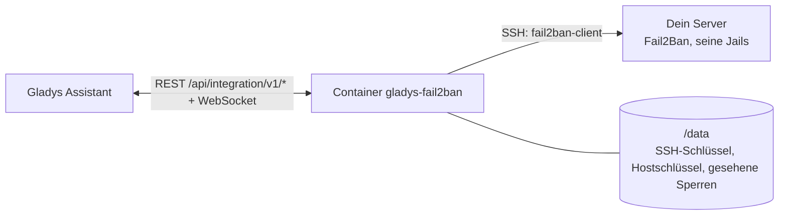
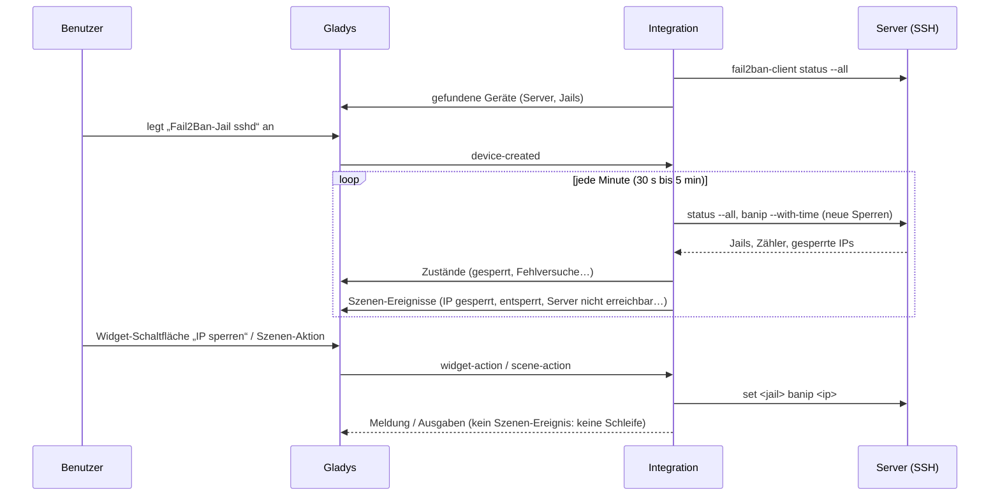
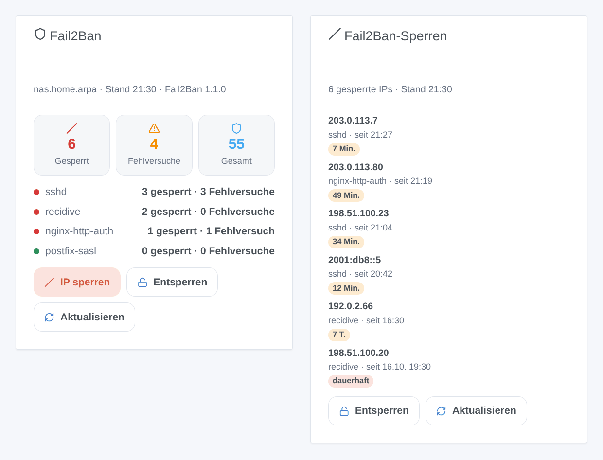

# Gladys Fail2Ban

[English](README.md) · [Français](README.fr.md) · **Deutsch** · [Español](README.es.md)

[](LICENSE)
[](https://github.com/William-De71/gladys-fail2ban/releases)
[](https://github.com/William-De71/gladys-fail2ban/actions/workflows/release.yml)
[](https://gladysassistant.com)


Externe Integration für [Gladys Assistant](https://gladysassistant.com) und **[Fail2Ban](https://github.com/fail2ban/fail2ban)**: die gesperrten IPs und Fehlversuche jeder Jail als Geräte, Szenen, wenn eine IP gesperrt wird oder Fail2Ban nicht mehr antwortet, und Widgets zum Sperren und Entsperren. Sie spricht per SSH mit Fail2Ban, auf dem Gladys-Rechner oder auf jedem anderen Server.

## Funktionen

- **Ein Server-Gerät**: gesperrte IPs, aktuelle Fehlversuche, Sperren seit dem Start, aktive Jails.
- **Ein Gerät pro Jail** (alle oder die aufgelisteten): gesperrte IPs, Fehlversuche, Sperren und Fehlversuche seit dem Start, zuletzt gesperrte IP.
- **4 Szenen-Auslöser**, **4 Szenen-Aktionen** und **2 Dashboard-Widgets** (unten).
- SSH mit einem von der Integration erzeugten Schlüssel (oder einem Passwort), geprüfter Hostschlüssel, eine zwischen zwei Lesungen gehaltene Verbindung; Lesungen alle 30 Sekunden bis 5 Minuten.
- Fail2Ban 0.10 bis 1.1, als Paket oder in Docker (`docker exec fail2ban fail2ban-client`).
- Konfigurations-Schaltflächen: Verbindung testen, öffentlichen Schlüssel anzeigen, Hostschlüssel vergessen, Diagnose.
- Vier Sprachen überall: Englisch, Französisch, Deutsch, Spanisch.

## Funktionsweise




Fail2Ban antwortet nur über einen Unix-Socket des Rechners, den es schützt, außer Reichweite eines Containers. Die Integration meldet sich per SSH an und führt mit ihrem eigenen Timer `fail2ban-client status --all` aus (oder vor Version 1.1 `status` und dann `status <jail>`). Jede Lesung wird mit der vorigen verglichen: eine neue Adresse löst **IP gesperrt** aus (mit der Uhrzeit der Sperre aus `get <jail> banip --with-time`), eine verschwundene Adresse **IP entsperrt**. Jedes Argument wird geprüft und maskiert, bevor es die entfernte Shell erreicht.



### Transport

Lokal (`"transports": ["local"]`): Der Katalog zeigt das Lokal-Abzeichen. Die Integration verbindet sich direkt mit dem angegebenen Server; nichts läuft über eine Cloud. Ist dieser Server ein VPS, läuft die SSH-Verbindung verschlüsselt über das Internet. Mit nur einem Kanal gibt es keine Schaltfläche „Lokale Verbindung bevorzugen“.

## Geräte und Funktionen

| Gerät                | Funktion                                | Kategorie / Typ          |
| -------------------- | --------------------------------------- | ------------------------ |
| Fail2Ban <Server>    | Gesperrte IPs (alle Jails)              | `counter-sensor/integer` |
| Fail2Ban <Server>    | Aktuelle Fehlversuche (alle Jails)      | `counter-sensor/integer` |
| Fail2Ban <Server>    | Sperren seit dem Start                  | `counter-sensor/integer` |
| Fail2Ban <Server>    | Aktive Jails                            | `counter-sensor/integer` |
| Fail2Ban-Jail <Name> | Gesperrte IPs, aktuelle Fehlversuche    | `counter-sensor/integer` |
| Fail2Ban-Jail <Name> | Sperren und Fehlversuche seit dem Start | `counter-sensor/integer` |
| Fail2Ban-Jail <Name> | Zuletzt gesperrte IP                    | `text/text`              |

Die Geräte werden vom eigenen Timer der Integration gelesen (`should_poll: false`). Die Zähler „seit dem Start“ beginnen bei null, wenn Fail2Ban neu startet.

## Szenen-Auslöser, Aktionen und Widgets



**Auslöser**

- **IP gesperrt**: eine IP kommt auf die Sperrliste einer Jail. Filter: Jail, Adresse. Variablen: `ip`, `jail`, `banned_count`, `total_banned`, `ban_seconds`, `permanent`, `until`, `server`.
- **IP entsperrt**: ihre Sperre ist abgelaufen oder wurde aufgehoben. Filter: Jail, Adresse.
- **Server nicht erreichbar**: Fail2Ban antwortet nicht mehr (bei einem Netzwerkfehler ab der zweiten fehlgeschlagenen Lesung). Filter: Grund. Variablen: `server`, `reason`, `message`.
- **Server wieder da**: er antwortet wieder.

**Aktionen**: eine IP (oder ein CIDR-Netz) in einer Jail sperren, eine IP entsperren (eine Jail oder alle), eine IP prüfen, eine Zusammenfassung lesen (Satz `summary`).

**Widgets**: **Fail2Ban** (Zähler, eine Zeile pro Jail, Formulare Sperren / Entsperren, Aktualisieren) und **Fail2Ban-Sperren** (letzte Sperren, verbleibende Dauer, Entsperren).

**Beispiele**

- Wenn **eine IP in `recidive` gesperrt wird** → `{{triggerEvent.data.ip}} gesperrt bis {{triggerEvent.data.until}}` an dein Handy senden.
- Wenn **deine eigene öffentliche Adresse gesperrt wird** → sie **entsperren** und dir eine Nachricht schicken.
- Jeden Montag um 8:00 → **Zusammenfassung lesen** und als Nachricht senden.

Änderungen durch Gladys (Szenen-Aktionen, Widget-Schaltflächen) lösen nichts aus.

## Voraussetzungen

- Gladys Assistant **5.3.0** oder neuer (Katalog-Suchbegriffe und Länder von Gladys 5.3, Widget-Schaltflächen mit Formular). Ältere Instanzen können die Integration nicht installieren.
- Ein Server mit Fail2Ban und SSH sowie ein Benutzer, der `fail2ban-client` ohne Passwort ausführen darf: siehe [docs/de.md](docs/de.md#den-server-vorbereiten) für die drei Befehle (Benutzer, sudoers-Regel, `authorized_keys`).

## Installation

- **Aus dem Store** von Gladys (Integrationen → Externe Integrationen), mit einem Klick, sobald indiziert.
- **Über die Repository-URL**: `https://github.com/William-De71/gladys-fail2ban`.
- **Entwicklermodus**: das Image lokal bauen (`docker build -t gladys-fail2ban .`) und aus Gladys installieren.

## Konfiguration

| Feld                   | Standard                  | Rolle                                                               |
| ---------------------- | ------------------------- | ------------------------------------------------------------------- |
| Adresse des Servers    | —                         | LAN-Adresse oder Hostname des Fail2Ban-Rechners (nie `localhost`).  |
| SSH-Port               | 22                        | Port seines SSH-Servers.                                            |
| SSH-Benutzer           | —                         | Der Benutzer, der `fail2ban-client` ausführen darf.                 |
| Authentifizierung      | Schlüssel der Integration | Oder Passwort.                                                      |
| SSH-Passwort           | —                         | Geheim; nur mit der Authentifizierung per Passwort.                 |
| Befehl fail2ban-client | `sudo -n fail2ban-client` | `docker exec fail2ban fail2ban-client`, `fail2ban-client` als root… |
| Hostschlüssel          | beim 1. Mal vertraut      | SHA256-Fingerabdruck/-abdrücke des Servers, um ihn festzulegen.     |
| Zu verfolgende Jails   | alle                      | `sshd, recidive`.                                                   |
| Leseintervall          | 1 Minute                  | 30 Sekunden bis 5 Minuten.                                          |
| Sprache der Texte      | automatisch               | Gerätenamen und Szenentexte.                                        |

## Verwendung

1. Den Server vorbereiten (Benutzer, sudoers-Regel), die Konfiguration ausfüllen und speichern.
2. Auf **Öffentlichen Schlüssel anzeigen** klicken, die Zeile in `authorized_keys` auf dem Server eintragen, dann **Verbindung testen**.
3. Im Tab **Entdecken** die Geräte „Fail2Ban …“ anlegen.
4. Die Widgets **Fail2Ban** und **Fail2Ban-Sperren** einem Dashboard hinzufügen und Szenen mit den Auslösern oben bauen.

## Entwicklung

```bash
npm install
npm test                       # node --test, berührt nie das Netzwerk
npm run lint && npm run format:check
npx github:GladysAssistant/integration-store . --skip-image-check
scripts/build-cover.sh         # cover.jpg aus docs/assets/cover.svg
docs/illustrations/render.sh   # docs/assets/widgets.<lang>.png
node .github/scripts/release.mjs next
```

Lokal liest das SDK `GLADYS_HOST_API_URL`, `GLADYS_INTEGRATION_TOKEN` und `GLADYS_INTEGRATION_SELECTOR`; `DEBUG=gladys-integration-sdk` zeigt die Logs des SDK und prüft jeden Widget-Inhalt. Die Tests steuern die Integration mit dem Fake-Gladys des SDK und einem Fake-`fail2ban-client`, dessen Antworten echten folgen (`test/fixtures/`, gelesen auf Fail2Ban 1.1.0). Die Regeln des Projekts stehen in [CLAUDE.md](CLAUDE.md).

## Release-Prozess


Jeder Merge auf `main` startet die CI und berechnet dann die Version aus den [Conventional Commits](https://www.conventionalcommits.org/) seit dem letzten Tag: `feat` → Minor, `fix` / `perf` → Patch, `!` oder `BREAKING CHANGE` → Major (unter 1.0.0 ein Minor); `docs`, `chore`, `ci`, `test`, `style`, `refactor`, `build` allein veröffentlichen nichts. Der Changelog-Abschnitt wird erzeugt, der Tag gepusht, das Multi-Architektur-Image gebaut, dann erhält `main` den Release-Commit, das GitHub-Release wird erstellt und ein letzter Job prüft das öffentliche Image, den Store-Validator und das Topic.

- Der Titel des Pull Requests wird zum Squash-Commit und dann zur Changelog-Zeile: auf Englisch und für die Nutzer schreiben (`pr-title.yml` prüft ihn). `CHANGELOG.md` nie von Hand bearbeiten.
- 1.0.0 ist eine Entscheidung: Actions → Release → Run workflow mit `release-as: 1.0.0`. `dry-run` zeigt Version und Notizen, ohne zu veröffentlichen.
- **Geschützter Branch**: Das Release pusht seinen Commit mit `GITHUB_TOKEN` auf `main`. Bei einem Ruleset auf `main` GitHub Actions in dessen Bypass-Liste aufnehmen (oder über eine GitHub App pushen), sonst schlägt der Veröffentlichungs-Job mit Hinweisen fehl.
- Nach dem ersten Release das Paket auf `ghcr.io` öffentlich machen (Package settings → Change visibility), sonst kann Gladys es nicht laden.

## Fehlerbehebung

Siehe [docs/de.md](docs/de.md#fehlerbehebung). Probleme bitte mit den Versionen von Gladys, der Integration und von Fail2Ban sowie den Zeilen der Schaltfläche **Diagnose** melden.

## Mitwirken

Issues und Pull Requests sind willkommen. Vor einem Pull Request `npm run format:check && npm run lint && npm test` ausführen und alle externen IDs und gespeicherten Schlüssel unverändert lassen (siehe [CLAUDE.md](CLAUDE.md)).

## Sicherheit

Siehe [SECURITY.md](SECURITY.md): Sicherheitslücken bitte privat melden. Die Integration hält eine Tür zu deinem Server, deshalb ist sie darauf ausgelegt, sie schmal zu halten: ein eigener Benutzer, der nur `fail2ban-client` ausführen darf, ein mit `restrict` markierter Schlüssel, geprüfter Hostschlüssel, jedes Argument geprüft und maskiert, das Passwort in einem nie protokollierten `secret`-Feld, der private Schlüssel nur in `/data`, ein schreibgeschützter Container mit einem Benutzer ohne root-Rechte.

## Kommende Bildschirmfotos

Die Bilder oben sind Illustrationen, keine Bildschirmfotos. Echte Bildschirmfotos kommen nach `docs/assets/screenshots/` (PNG, 1280 × 800): `configuration.png`, `discovery.png`, `device.png`, `scene.png`.

## Lizenz

[Apache License 2.0](LICENSE) — siehe auch [NOTICE](NOTICE). Fail2Ban ist ein eigenständiges Projekt (GPL-2.0), das diese Integration über seine Kommandozeile steuert, ohne es mitzuliefern. Danke an die Dokumentation und das SDK von Gladys und an die Maintainer von Fail2Ban.
