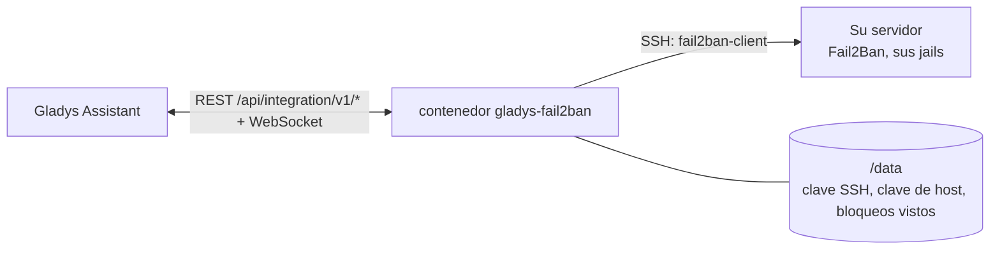
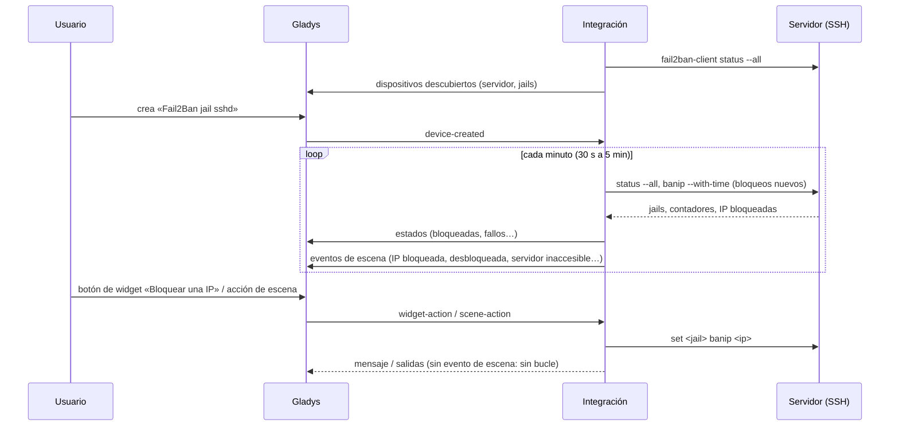
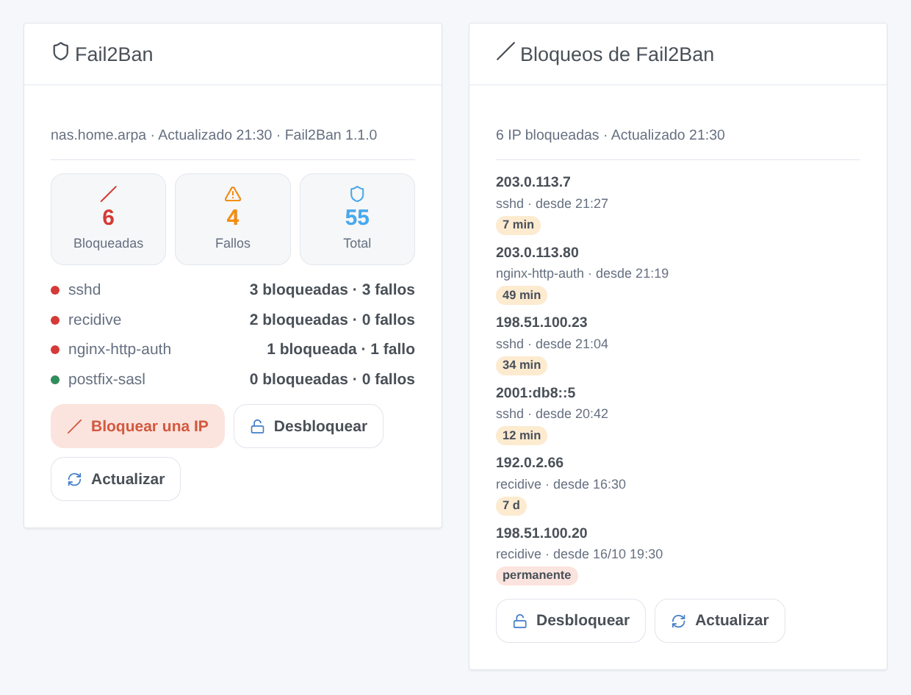

# Gladys Fail2Ban

[English](README.md) · [Français](README.fr.md) · [Deutsch](README.de.md) · **Español**

[](LICENSE)
[](https://github.com/William-De71/gladys-fail2ban/releases)
[](https://github.com/William-De71/gladys-fail2ban/actions/workflows/release.yml)
[](https://gladysassistant.com)


Integración externa de [Gladys Assistant](https://gladysassistant.com) para **[Fail2Ban](https://github.com/fail2ban/fail2ban)**: las IP bloqueadas y los fallos de cada jail como dispositivos, escenas cuando se bloquea una IP o Fail2Ban deja de responder, y widgets para bloquear y desbloquear. Habla con Fail2Ban por SSH, en la máquina de Gladys o en cualquier otro servidor.

## Funcionalidades

- **Un dispositivo servidor**: IP bloqueadas, fallos actuales, bloqueos desde el arranque, jails activas.
- **Un dispositivo por jail** (todas, o las que indique): IP bloqueadas, fallos, bloqueos y fallos desde el arranque, última IP bloqueada.
- **4 disparadores de escena**, **4 acciones de escena** y **2 widgets** de panel (más abajo).
- SSH con una clave que genera la integración (o una contraseña), clave de host comprobada, una conexión mantenida entre lecturas; lecturas cada 30 segundos a 5 minutos.
- Fail2Ban 0.10 a 1.1, como paquete o en Docker (`docker exec fail2ban fail2ban-client`).
- Botones de configuración: probar la conexión, mostrar la clave pública, olvidar la clave de host, diagnóstico.
- Cuatro idiomas en todas partes: inglés, francés, alemán, español.

## Cómo funciona




Fail2Ban solo responde en un socket Unix de la máquina que protege, fuera del alcance de un contenedor. La integración se conecta por SSH y ejecuta `fail2ban-client status --all` (o `status` y luego `status <jail>` antes de la versión 1.1) con su propio temporizador. Cada lectura se compara con la anterior: una dirección nueva dispara **IP bloqueada** (con la hora del bloqueo leída con `get <jail> banip --with-time`), una dirección que desaparece dispara **IP desbloqueada**. Cada argumento se valida y se protege antes de llegar al shell remoto.



### Transporte

Local (`"transports": ["local"]`): el catálogo muestra la insignia local. La integración se conecta directamente al servidor indicado; nada pasa por una nube. Si ese servidor es un VPS, la conexión SSH atraviesa internet, cifrada. Con un solo canal no hay botón «Preferir la conexión local».

## Dispositivos y funcionalidades

| Dispositivo            | Funcionalidad                       | Categoría / tipo         |
| ---------------------- | ----------------------------------- | ------------------------ |
| Fail2Ban <servidor>    | IP bloqueadas (todas las jails)     | `counter-sensor/integer` |
| Fail2Ban <servidor>    | Fallos actuales (todas las jails)   | `counter-sensor/integer` |
| Fail2Ban <servidor>    | Bloqueos desde el arranque          | `counter-sensor/integer` |
| Fail2Ban <servidor>    | Jails activas                       | `counter-sensor/integer` |
| Fail2Ban jail <nombre> | IP bloqueadas, fallos actuales      | `counter-sensor/integer` |
| Fail2Ban jail <nombre> | Bloqueos y fallos desde el arranque | `counter-sensor/integer` |
| Fail2Ban jail <nombre> | Última IP bloqueada                 | `text/text`              |

Los dispositivos los lee el temporizador de la integración (`should_poll: false`). Los contadores «desde el arranque» vuelven a cero cuando Fail2Ban se reinicia.

## Disparadores, acciones de escena y widgets



**Disparadores**

- **IP bloqueada**: una IP entra en la lista de bloqueadas de una jail. Filtros: jail, dirección. Variables: `ip`, `jail`, `banned_count`, `total_banned`, `ban_seconds`, `permanent`, `until`, `server`.
- **IP desbloqueada**: su bloqueo caducó o se levantó. Filtros: jail, dirección.
- **Servidor inaccesible**: Fail2Ban deja de responder (a la segunda lectura fallida por un error de red). Filtro: motivo. Variables: `server`, `reason`, `message`.
- **Servidor de vuelta**: vuelve a responder.

**Acciones**: bloquear una IP (o una red CIDR) en una jail, desbloquear una IP (una jail o todas), comprobar una IP, leer un resumen (frase `summary`).

**Widgets**: **Fail2Ban** (contadores, una fila por jail, formularios Bloquear / Desbloquear, Actualizar) y **Bloqueos de Fail2Ban** (últimos bloqueos, tiempo restante, Desbloquear).

**Ejemplos**

- Cuando **se bloquea una IP en `recidive`** → enviar `{{triggerEvent.data.ip}} bloqueada hasta {{triggerEvent.data.until}}` a su teléfono.
- Cuando **se bloquea su propia dirección pública** → **desbloquearla** y enviarse un mensaje.
- Cada lunes a las 8:00 → **leer un resumen** y enviarlo por mensaje.

Los cambios hechos por Gladys (acciones de escena, botones de widget) no disparan nada.

## Requisitos

- Gladys Assistant **5.2.0** o posterior (botones de widget con formulario). Las instancias más antiguas no pueden instalar la integración.
- Un servidor con Fail2Ban y SSH, y un usuario autorizado a ejecutar `fail2ban-client` sin contraseña: vea [docs/es.md](docs/es.md#preparar-el-servidor) para los tres comandos (usuario, regla sudoers, `authorized_keys`).

## Instalación

- **Desde la tienda** de Gladys (Integraciones → Integraciones externas), con un clic, una vez indexada.
- **Desde la URL del repositorio**: `https://github.com/William-De71/gladys-fail2ban`.
- **Modo desarrollador**: construya la imagen en local (`docker build -t gladys-fail2ban .`) e instálela desde Gladys.

## Configuración

| Campo                   | Por defecto               | Función                                                                      |
| ----------------------- | ------------------------- | ---------------------------------------------------------------------------- |
| Dirección del servidor  | —                         | Dirección local o nombre de host de la máquina Fail2Ban (nunca `localhost`). |
| Puerto SSH              | 22                        | Puerto de su servidor SSH.                                                   |
| Usuario SSH             | —                         | El usuario autorizado a ejecutar `fail2ban-client`.                          |
| Autenticación           | Clave de la integración   | O Contraseña.                                                                |
| Contraseña SSH          | —                         | Secreto; solo con la autenticación por contraseña.                           |
| Comando fail2ban-client | `sudo -n fail2ban-client` | `docker exec fail2ban fail2ban-client`, `fail2ban-client` como root…         |
| Clave de host           | de confianza la 1.ª vez   | Huella(s) SHA256 del servidor, para fijarla.                                 |
| Jails a seguir          | todas                     | `sshd, recidive`.                                                            |
| Intervalo de lectura    | 1 minuto                  | De 30 segundos a 5 minutos.                                                  |
| Idioma de los textos    | automático                | Nombres de los dispositivos y textos de las escenas.                         |

## Uso

1. Prepare el servidor (usuario, regla sudoers), rellene la configuración y guarde.
2. Haga clic en **Mostrar la clave pública** y añada la línea a `authorized_keys` en el servidor, luego **Probar la conexión**.
3. En la pestaña **Descubrir**, cree los dispositivos «Fail2Ban …».
4. Añada los widgets **Fail2Ban** y **Bloqueos de Fail2Ban** a un panel, y cree escenas con los disparadores de arriba.

## Desarrollo

```bash
npm install
npm test                       # node --test, nunca toca la red
npm run lint && npm run format:check
npx github:GladysAssistant/integration-store . --skip-image-check
scripts/build-cover.sh         # cover.jpg desde docs/assets/cover.svg
docs/illustrations/render.sh   # docs/assets/widgets.<lang>.png
node .github/scripts/release.mjs next
```

En local, el SDK lee `GLADYS_HOST_API_URL`, `GLADYS_INTEGRATION_TOKEN` y `GLADYS_INTEGRATION_SELECTOR`; `DEBUG=gladys-integration-sdk` muestra los registros del SDK y comprueba cada contenido de widget. Las pruebas manejan la integración con el Gladys falso del SDK y un `fail2ban-client` falso cuyas respuestas siguen respuestas reales (`test/fixtures/`, leídas en Fail2Ban 1.1.0). Las reglas del proyecto están en [CLAUDE.md](CLAUDE.md).

## Proceso de publicación


Cada fusión en `main` lanza la CI y calcula la versión a partir de los [Conventional Commits](https://www.conventionalcommits.org/) desde la última etiqueta: `feat` → menor, `fix` / `perf` → parche, `!` o `BREAKING CHANGE` → mayor (una menor por debajo de 1.0.0); `docs`, `chore`, `ci`, `test`, `style`, `refactor`, `build` solos no publican nada. Se genera la sección del changelog, se sube la etiqueta, se construye la imagen multiarquitectura, después `main` recibe el commit de publicación, se crea la GitHub Release y un último job comprueba la imagen pública, el validador de la tienda y el topic.

- El título de la pull request se convierte en el commit squash y luego en la línea del changelog: escríbalo en inglés, para el usuario (`pr-title.yml` lo comprueba). No edite nunca `CHANGELOG.md` a mano.
- 1.0.0 es una decisión: Actions → Release → Run workflow con `release-as: 1.0.0`. `dry-run` muestra la versión y las notas sin publicar nada.
- **Rama protegida**: la publicación sube su commit a `main` con `GITHUB_TOKEN`. Con un ruleset en `main`, añada GitHub Actions a su lista de excepciones (o suba mediante una GitHub App); si no, el job de publicación falla con instrucciones.
- Tras la primera publicación, haga público el paquete de `ghcr.io` (Package settings → Change visibility); si no, Gladys no puede descargarlo.

## Solución de problemas

Vea [docs/es.md](docs/es.md#solución-de-problemas). Informe de los problemas con las versiones de Gladys, de la integración y de Fail2Ban, y las líneas del botón **Diagnóstico**.

## Contribuir

Las incidencias y pull requests son bienvenidas. Ejecute `npm run format:check && npm run lint && npm test` antes de abrir una pull request, y mantenga sin cambios todos los identificadores externos y claves guardadas (vea [CLAUDE.md](CLAUDE.md)).

## Seguridad

Vea [SECURITY.md](SECURITY.md): informe de las vulnerabilidades en privado. La integración tiene una puerta a su servidor, así que está pensada para mantenerla estrecha: un usuario dedicado autorizado solo a ejecutar `fail2ban-client`, una clave marcada `restrict`, la clave de host comprobada, cada argumento validado y protegido, la contraseña en un campo `secret` que nunca se registra, la clave privada solo en `/data`, un contenedor de solo lectura con un usuario sin privilegios de root.

## Capturas pendientes

Las imágenes de arriba son ilustraciones, no capturas de pantalla. Las capturas reales irán en `docs/assets/screenshots/` (PNG, 1280 × 800): `configuration.png`, `discovery.png`, `device.png`, `scene.png`.

## Licencia

[Licencia Apache 2.0](LICENSE) — vea también [NOTICE](NOTICE). Fail2Ban es un proyecto aparte (GPL-2.0) que esta integración maneja mediante su línea de comandos, sin incluirlo. Gracias a la documentación y al SDK de Gladys, y a los mantenedores de Fail2Ban.
