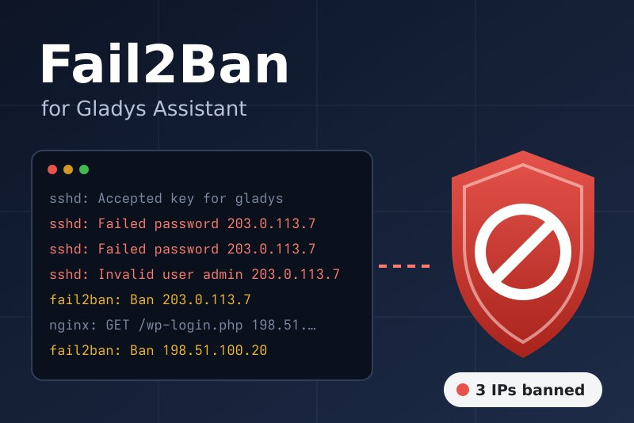
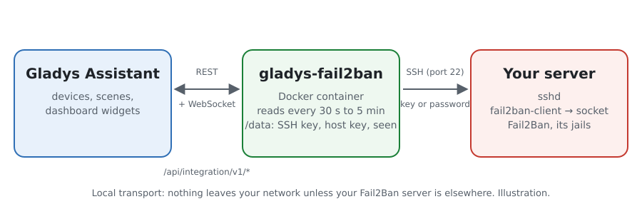
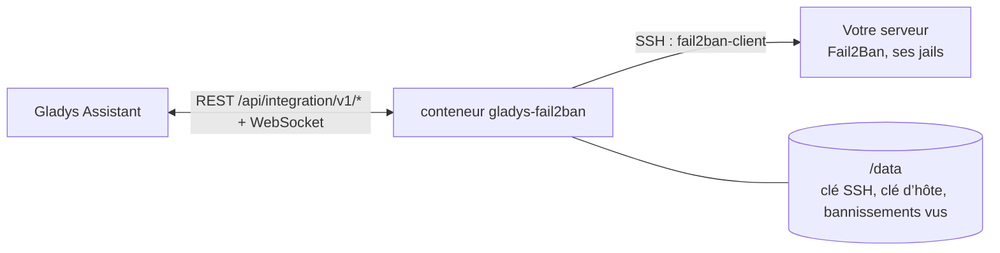
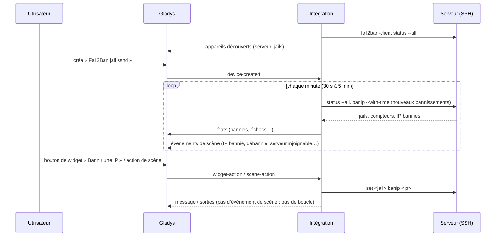
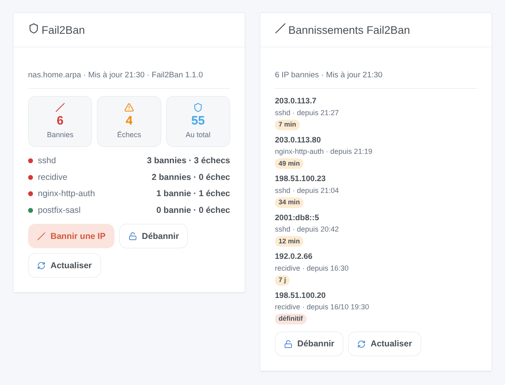

# Gladys Fail2Ban

[English](README.md) · **Français** · [Deutsch](README.de.md) · [Español](README.es.md)

[](LICENSE)
[](https://github.com/William-De71/gladys-fail2ban/releases)
[](https://github.com/William-De71/gladys-fail2ban/actions/workflows/release.yml)
[](https://gladysassistant.com)



Intégration externe [Gladys Assistant](https://gladysassistant.com) pour **[Fail2Ban](https://github.com/fail2ban/fail2ban)** : les IP bannies et les échecs de chaque jail en appareils, des scènes quand une IP est bannie ou que Fail2Ban ne répond plus, et des widgets pour bannir et débannir. Elle parle à Fail2Ban en SSH, sur la machine de Gladys ou sur tout autre serveur.

## Fonctionnalités

- **Un appareil serveur** : IP bannies, échecs en cours, bannissements depuis le démarrage, jails actives.
- **Un appareil par jail** (toutes, ou celles que vous listez) : IP bannies, échecs, bannissements et échecs depuis le démarrage, dernière IP bannie.
- **4 déclencheurs de scène**, **4 actions de scène** et **2 widgets** de tableau de bord (ci-dessous).
- SSH avec une clé générée par l’intégration (ou un mot de passe), clé d’hôte vérifiée, une connexion gardée entre deux lectures ; lectures toutes les 30 secondes à 5 minutes.
- Fail2Ban 0.10 à 1.1, en paquet ou dans Docker (`docker exec fail2ban fail2ban-client`).
- Boutons de configuration : tester la connexion, afficher la clé publique, oublier la clé d’hôte, diagnostic.
- Quatre langues partout : anglais, français, allemand, espagnol.

## Fonctionnement





Fail2Ban ne répond que sur un socket Unix de la machine qu’il protège, hors de portée d’un conteneur. L’intégration se connecte en SSH et lance `fail2ban-client status --all` (ou `status` puis `status <jail>` avant la version 1.1) selon son propre minuteur. Chaque lecture est comparée à la précédente : une adresse apparue déclenche **IP bannie** (avec l’heure du bannissement lue par `get <jail> banip --with-time`), une adresse disparue déclenche **IP débannie**. Chaque argument est validé et protégé avant d’atteindre le shell distant.



### Transport

Local (`"transports": ["local"]`) : le catalogue affiche le badge local. L’intégration se connecte directement au serveur indiqué ; rien ne passe par un cloud. Si ce serveur est un VPS, la connexion SSH traverse internet, chiffrée. Avec un seul canal, il n’y a pas de bouton « Préférer la connexion locale ».

## Appareils et fonctionnalités

| Appareil            | Fonctionnalité                              | Catégorie / type         |
| ------------------- | ------------------------------------------- | ------------------------ |
| Fail2Ban <serveur>  | IP bannies (toutes les jails)               | `counter-sensor/integer` |
| Fail2Ban <serveur>  | Échecs en cours (toutes les jails)          | `counter-sensor/integer` |
| Fail2Ban <serveur>  | Bannissements depuis le démarrage           | `counter-sensor/integer` |
| Fail2Ban <serveur>  | Jails actives                               | `counter-sensor/integer` |
| Fail2Ban jail <nom> | IP bannies, échecs en cours                 | `counter-sensor/integer` |
| Fail2Ban jail <nom> | Bannissements et échecs depuis le démarrage | `counter-sensor/integer` |
| Fail2Ban jail <nom> | Dernière IP bannie                          | `text/text`              |

Les appareils sont lus par le minuteur de l’intégration (`should_poll: false`). Les compteurs « depuis le démarrage » repartent de zéro quand Fail2Ban redémarre.

## Déclencheurs, actions de scène et widgets



**Déclencheurs**

- **IP bannie** : une IP entre dans la liste des bannies d’une jail. Filtres : jail, adresse. Variables : `ip`, `jail`, `banned_count`, `total_banned`, `ban_seconds`, `permanent`, `until`, `server`.
- **IP débannie** : son bannissement a expiré ou a été levé. Filtres : jail, adresse.
- **Serveur injoignable** : Fail2Ban ne répond plus (à la deuxième lecture ratée pour une erreur réseau). Filtre : raison. Variables : `server`, `reason`, `message`.
- **Serveur de retour** : il répond de nouveau.

**Actions** : bannir une IP (ou un réseau CIDR) dans une jail, débannir une IP (une jail ou toutes), vérifier une IP, lire un résumé (phrase `summary`).

**Widgets** : **Fail2Ban** (compteurs, une ligne par jail, formulaires Bannir / Débannir, Actualiser) et **Bannissements Fail2Ban** (derniers bannissements, durée restante, Débannir).

**Exemples**

- Quand **une IP est bannie dans `recidive`** → envoyer `{{triggerEvent.data.ip}} bannie jusqu’à {{triggerEvent.data.until}}` sur votre téléphone.
- Quand **votre propre adresse publique est bannie** → la **débannir** et vous envoyer un message.
- Chaque lundi à 8 h → **lire un résumé** et l’envoyer par message.

Les changements faits par Gladys (actions de scène, boutons de widget) ne déclenchent rien.

## Prérequis

- Gladys Assistant **5.3.0** ou plus récent (mots-clés et pays du catalogue de Gladys 5.3, boutons de widget à formulaire). Les instances plus anciennes ne peuvent pas installer l’intégration.
- Un serveur avec Fail2Ban et SSH, et un utilisateur autorisé à lancer `fail2ban-client` sans mot de passe : voir [docs/fr.md](docs/fr.md#préparer-le-serveur) pour les trois commandes (utilisateur, règle sudoers, `authorized_keys`).

## Installation

- **Depuis le store** de Gladys (Intégrations → Intégrations externes), en un clic, une fois indexée.
- **Depuis l’URL du dépôt** : `https://github.com/William-De71/gladys-fail2ban`.
- **Mode développeur** : construisez l’image en local (`docker build -t gladys-fail2ban .`) et installez-la depuis Gladys.

## Configuration

| Champ                    | Par défaut                   | Rôle                                                                      |
| ------------------------ | ---------------------------- | ------------------------------------------------------------------------- |
| Adresse du serveur       | —                            | Adresse locale ou nom d’hôte de la machine Fail2Ban (jamais `localhost`). |
| Port SSH                 | 22                           | Port de son serveur SSH.                                                  |
| Utilisateur SSH          | —                            | L’utilisateur autorisé à lancer `fail2ban-client`.                        |
| Authentification         | Clé de l’intégration         | Ou Mot de passe.                                                          |
| Mot de passe SSH         | —                            | Secret ; uniquement avec l’authentification par mot de passe.             |
| Commande fail2ban-client | `sudo -n fail2ban-client`    | `docker exec fail2ban fail2ban-client`, `fail2ban-client` en root…        |
| Clé d’hôte               | approuvée à la 1re connexion | Empreinte(s) SHA256 du serveur, pour la fixer.                            |
| Jails à suivre           | toutes                       | `sshd, recidive`.                                                         |
| Intervalle de lecture    | 1 minute                     | De 30 secondes à 5 minutes.                                               |
| Langue des textes        | automatique                  | Noms des appareils et textes des scènes.                                  |

## Utilisation

1. Préparez le serveur (utilisateur, règle sudoers), remplissez la configuration et enregistrez.
2. Cliquez sur **Afficher la clé publique** et ajoutez la ligne à `authorized_keys` sur le serveur, puis **Tester la connexion**.
3. Dans l’onglet **Découverte**, créez les appareils « Fail2Ban … ».
4. Ajoutez les widgets **Fail2Ban** et **Bannissements Fail2Ban** à un tableau de bord, et construisez des scènes avec les déclencheurs ci-dessus.

## Développement

```bash
npm install
npm test                       # node --test, ne touche jamais le réseau
npm run lint && npm run format:check
npx github:GladysAssistant/integration-store . --skip-image-check
scripts/build-cover.sh         # cover.jpg depuis docs/assets/cover.svg
docs/illustrations/render.sh   # docs/assets/widgets.<lang>.png
node .github/scripts/release.mjs next
```

En local, le SDK lit `GLADYS_HOST_API_URL`, `GLADYS_INTEGRATION_TOKEN` et `GLADYS_INTEGRATION_SELECTOR` ; `DEBUG=gladys-integration-sdk` affiche les journaux du SDK et vérifie chaque contenu de widget. Les tests pilotent l’intégration avec le faux Gladys du SDK et un faux `fail2ban-client` dont les réponses suivent de vraies réponses (`test/fixtures/`, relevées sur Fail2Ban 1.1.0). Les règles du projet sont dans [CLAUDE.md](CLAUDE.md).

## Processus de release


Chaque fusion sur `main` lance la CI, puis calcule la version à partir des [Conventional Commits](https://www.conventionalcommits.org/) depuis le dernier tag : `feat` → mineure, `fix` / `perf` → correctif, `!` ou `BREAKING CHANGE` → majeure (une mineure sous 1.0.0) ; `docs`, `chore`, `ci`, `test`, `style`, `refactor`, `build` seuls ne publient rien. La section du changelog est générée, le tag poussé, l’image multi-architecture construite, puis `main` reçoit le commit de release, la release GitHub est créée et un dernier job vérifie l’image publique, le validateur du store et le topic.

- Le titre de la pull request devient le commit squash, puis la ligne du changelog : écrivez-le en anglais, pour l’utilisateur (`pr-title.yml` le vérifie). N’éditez jamais `CHANGELOG.md` à la main.
- 1.0.0 est une décision : Actions → Release → Run workflow avec `release-as: 1.0.0`. `dry-run` affiche la version et les notes sans rien publier.
- **Branche protégée** : la release pousse son commit sur `main` avec `GITHUB_TOKEN`. Avec un ruleset sur `main`, ajoutez GitHub Actions à sa liste de contournement (ou poussez via une GitHub App), sinon le job de publication échoue avec des instructions.
- Après la première release, rendez public le package `ghcr.io` (Package settings → Change visibility), sinon Gladys ne peut pas le télécharger.

## Dépannage

Voir [docs/fr.md](docs/fr.md#dépannage). Signalez les problèmes avec les versions de Gladys, de l’intégration et de Fail2Ban, et les lignes du bouton **Diagnostic**.

## Contribuer

Les tickets et pull requests sont les bienvenus. Lancez `npm run format:check && npm run lint && npm test` avant d’ouvrir une pull request, et gardez inchangés tous les identifiants externes et clés stockées (voir [CLAUDE.md](CLAUDE.md)).

## Sécurité

Voir [SECURITY.md](SECURITY.md) : signalez les vulnérabilités en privé. L’intégration tient une porte vers votre serveur, elle est donc conçue pour la garder étroite : un utilisateur dédié autorisé à lancer `fail2ban-client` seulement, une clé marquée `restrict`, la clé d’hôte vérifiée, chaque argument validé et protégé, le mot de passe dans un champ `secret` jamais journalisé, la clé privée dans `/data` seulement, un conteneur en lecture seule sous un utilisateur non root.

## Captures à venir

Les images ci-dessus sont des illustrations, pas des captures d’écran. Les vraies captures iront dans `docs/assets/screenshots/` (PNG, 1280 × 800) : `configuration.png`, `discovery.png`, `device.png`, `scene.png`.

## Licence

[Licence Apache 2.0](LICENSE) — voir aussi [NOTICE](NOTICE). Fail2Ban est un projet distinct (GPL-2.0) que cette intégration pilote par sa ligne de commande, sans l’inclure. Merci à la documentation et au SDK de Gladys, et aux mainteneurs de Fail2Ban.
