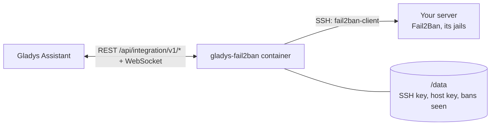
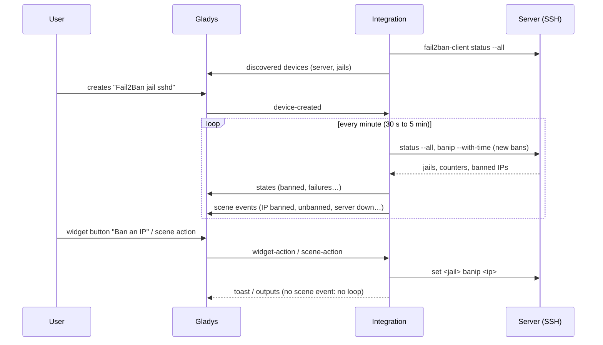
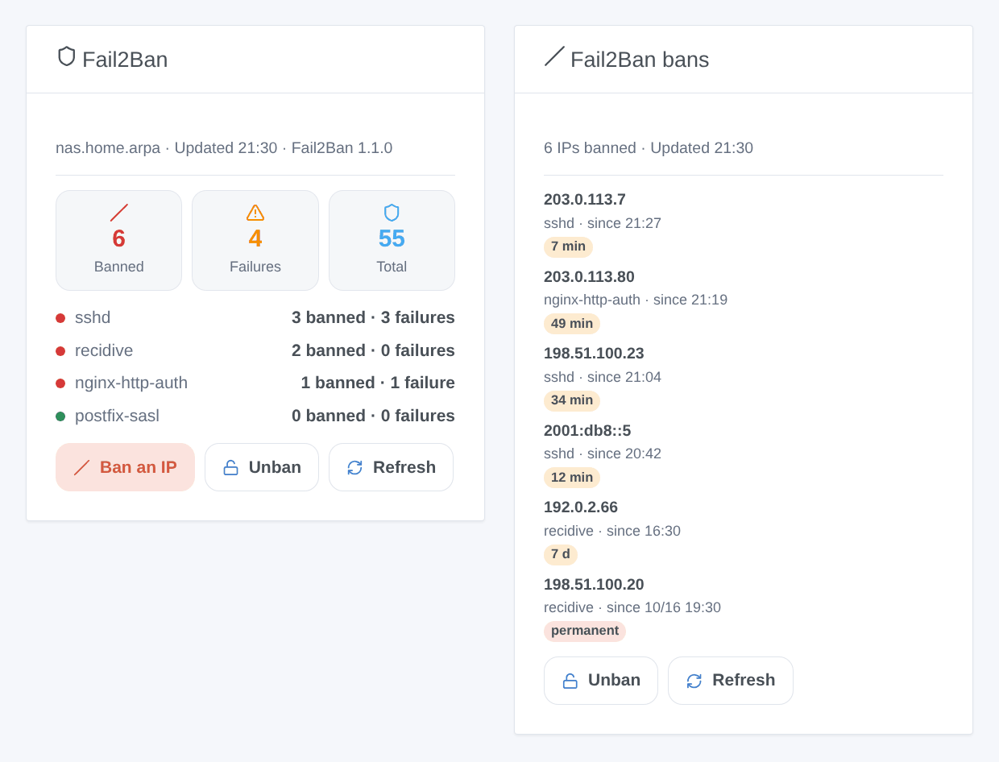

# Gladys Fail2Ban

**English** · [Français](README.fr.md) · [Deutsch](README.de.md) · [Español](README.es.md)

[](LICENSE)
[](https://github.com/William-De71/gladys-fail2ban/releases)
[](https://github.com/William-De71/gladys-fail2ban/actions/workflows/release.yml)
[](https://gladysassistant.com)


[Gladys Assistant](https://gladysassistant.com) external integration for **[Fail2Ban](https://github.com/fail2ban/fail2ban)**: the banned IPs and the failures of each jail as devices, scenes when an IP is banned or Fail2Ban stops answering, and dashboard widgets to ban and unban. It talks to Fail2Ban over SSH, on the Gladys host or on any other server.

## Features

- **A server device**: IPs banned now, failures now, bans since start, jails running.
- **One device per jail** (all, or the ones you list): IPs banned now, failures, bans and failures since start, last banned IP.
- **4 scene triggers**, **4 scene actions** and **2 dashboard widgets** (below).
- SSH with a key the integration generates (or a password), host key checked, one connection kept between readings; readings every 30 seconds to 5 minutes.
- Fail2Ban 0.10 to 1.1, as a package or in Docker (`docker exec fail2ban fail2ban-client`).
- Configuration buttons: test the connection, show the public key, forget the host key, diagnostic.
- Four languages everywhere: English, French, German, Spanish.

## How it works




Fail2Ban only answers on a Unix socket of the machine it protects, which a container cannot reach. The integration logs in over SSH and runs `fail2ban-client status --all` (or `status` then `status <jail>` on versions before 1.1) on its own timer. Each reading is compared with the previous one: an address that appeared fires **IP banned** (with the time of the ban from `get <jail> banip --with-time`), an address that left fires **IP unbanned**. Every argument is validated and quoted before it reaches the remote shell.



### Transport

Local (`"transports": ["local"]`): the catalog shows the local badge. The integration connects directly to the server you name; nothing goes through a cloud. If that server is a VPS, the SSH connection crosses the internet, encrypted. With a single channel there is no "prefer the local connection" button.

## Devices and features

| Device               | Feature                                  | Category / type          |
| -------------------- | ---------------------------------------- | ------------------------ |
| Fail2Ban <server>    | IPs banned now (all jails)               | `counter-sensor/integer` |
| Fail2Ban <server>    | Failures now (all jails)                 | `counter-sensor/integer` |
| Fail2Ban <server>    | Bans since Fail2Ban started              | `counter-sensor/integer` |
| Fail2Ban <server>    | Jails running                            | `counter-sensor/integer` |
| Fail2Ban jail <name> | IPs banned now, failures now             | `counter-sensor/integer` |
| Fail2Ban jail <name> | Bans and failures since Fail2Ban started | `counter-sensor/integer` |
| Fail2Ban jail <name> | Last banned IP                           | `text/text`              |

The devices are read on the integration's own timer (`should_poll: false`). The "since start" counters restart at zero when Fail2Ban restarts.

## Scene triggers, actions and widgets



**Triggers**

- **IP banned**: an IP enters the banned list of a jail. Filters: jail, address. Variables: `ip`, `jail`, `banned_count`, `total_banned`, `ban_seconds`, `permanent`, `until`, `server`.
- **IP unbanned**: its ban expired or someone lifted it. Filters: jail, address.
- **Server unreachable**: Fail2Ban stops answering (at the second failed reading for a network error). Filter: reason. Variables: `server`, `reason`, `message`.
- **Server back**: it answers again.

**Actions**: ban an IP (or a CIDR network) in a jail, unban an IP (one jail or all), check an IP, read a summary (`summary` sentence).

**Widgets**: **Fail2Ban** (counters, one row per jail, Ban / Unban forms, Refresh) and **Fail2Ban bans** (latest bans, what is left of each, Unban).

**Examples**

- When **an IP is banned in `recidive`** → send `{{triggerEvent.data.ip}} banned until {{triggerEvent.data.until}}` to your phone.
- When **your own public address is banned** → **unban it** and send yourself a message.
- Every Monday at 8:00 → **read a summary** and send it by message.

Changes made by Gladys (scene actions, widget buttons) fire no trigger.

## Requirements

- Gladys Assistant **5.2.0** or later (widget buttons with a form). Older instances cannot install the integration.
- A server running Fail2Ban with SSH, and a user allowed to run `fail2ban-client` without a password: see [docs/en.md](docs/en.md#prepare-the-server) for the three commands (user, sudoers rule, `authorized_keys`).

## Installation

- **From the store** of Gladys (Integrations → External integrations), in one click, once indexed.
- **From the repository URL**: `https://github.com/William-De71/gladys-fail2ban`.
- **Developer mode**: build the image locally (`docker build -t gladys-fail2ban .`) and install it from Gladys.

## Configuration

| Field                   | Default                   | Role                                                                  |
| ----------------------- | ------------------------- | --------------------------------------------------------------------- |
| Address of the server   | —                         | LAN address or host name of the Fail2Ban machine (never `localhost`). |
| SSH port                | 22                        | Port of its SSH server.                                               |
| SSH user                | —                         | The user allowed to run `fail2ban-client`.                            |
| Authentication          | Key of the integration    | Or Password.                                                          |
| SSH password            | —                         | Secret; only with the Password authentication.                        |
| fail2ban-client command | `sudo -n fail2ban-client` | `docker exec fail2ban fail2ban-client`, `fail2ban-client` as root…    |
| Host key                | trusted on first use      | SHA256 fingerprint(s) of the server, to pin it.                       |
| Jails to follow         | all                       | `sshd, recidive`.                                                     |
| Reading interval        | 1 minute                  | 30 seconds to 5 minutes.                                              |
| Language of the texts   | automatic                 | Device names and scene texts.                                         |

## Usage

1. Prepare the server (user, sudoers rule), fill in the configuration and save.
2. Press **Show the public key** and add the line to `authorized_keys` on the server, then **Test the connection**.
3. In the **Discover** tab, create the "Fail2Ban …" devices.
4. Add the **Fail2Ban** and **Fail2Ban bans** widgets to a dashboard, and build scenes with the triggers above.

## Development

```bash
npm install
npm test                       # node --test, never touches the network
npm run lint && npm run format:check
npx github:GladysAssistant/integration-store . --skip-image-check
scripts/build-cover.sh         # cover.jpg from docs/assets/cover.svg
docs/illustrations/render.sh   # docs/assets/widgets.<lang>.png
node .github/scripts/release.mjs next
```

Locally, the SDK reads `GLADYS_HOST_API_URL`, `GLADYS_INTEGRATION_TOKEN` and `GLADYS_INTEGRATION_SELECTOR`; `DEBUG=gladys-integration-sdk` shows the SDK logs and checks every widget content. The tests drive the integration with the fake Gladys of the SDK and a fake `fail2ban-client` whose answers follow real ones (`test/fixtures/`, read on Fail2Ban 1.1.0). The rules of the project are in [CLAUDE.md](CLAUDE.md).

## Release process


Every merge on `main` runs the CI, then computes the version from the [Conventional Commits](https://www.conventionalcommits.org/) since the last tag: `feat` → minor, `fix` / `perf` → patch, `!` or `BREAKING CHANGE` → major (a minor below 1.0.0); `docs`, `chore`, `ci`, `test`, `style`, `refactor`, `build` alone publish nothing. The changelog section is generated, the tag pushed, the multi-architecture image built, then `main` receives the release commit, the GitHub Release is created and a last job checks the public image, the store validator and the topic.

- The pull request title becomes the squash commit, then the changelog line: write it in English, for the user (`pr-title.yml` checks it). Never edit `CHANGELOG.md` by hand.
- 1.0.0 is a decision: Actions → Release → Run workflow with `release-as: 1.0.0`. `dry-run` shows the version and the notes without publishing.
- **Protected branch**: the release pushes its commit to `main` with `GITHUB_TOKEN`. With a ruleset on `main`, add GitHub Actions to its bypass list (or push through a GitHub App), otherwise the publish job fails with instructions.
- After the first release, make the `ghcr.io` package public (Package settings → Change visibility), or Gladys cannot pull it.

## Troubleshooting

See [docs/en.md](docs/en.md#troubleshooting). Report issues with the versions of Gladys, of the integration and of Fail2Ban, and the lines of the **Diagnostic** button.

## Contributing

Issues and pull requests are welcome. Run `npm run format:check && npm run lint && npm test` before opening a pull request, and keep every external id and stored key unchanged (see [CLAUDE.md](CLAUDE.md)).

## Security

See [SECURITY.md](SECURITY.md): report vulnerabilities privately. The integration holds a door to your server, so it is built to keep it narrow: a dedicated user allowed to run `fail2ban-client` only, a key marked `restrict`, the host key checked, every argument validated and quoted, the password a `secret` field never logged, the private key in `/data` only, a read-only container as a non-root user.

## Screenshots to come

The images above are illustrations, not screenshots. Real screenshots will go in `docs/assets/screenshots/` (PNG, 1280 × 800): `configuration.png`, `discovery.png`, `device.png`, `scene.png`.

## License

[Apache License 2.0](LICENSE) — see also [NOTICE](NOTICE). Fail2Ban is a separate project (GPL-2.0) that this integration drives through its command line, without including it. Thanks to the Gladys documentation and SDK, and to the Fail2Ban maintainers.
